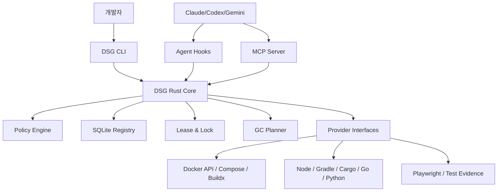

# 아키텍처 설계

## Boundaries
1. UI와 Agent Extension은 권한 없는 클라이언트이다.
2. Policy가 Global > Project > Session으로 결합하되 프로젝트가 상위 금지 항목을 풀 수 없다.
3. 핵심 실행은 allow/warn/deny/approval_required 4상태로 분리.
4. GC는 `plan → 승인 → 재확인 → apply → 감사`의 트랜잭션성 workflow.
5. 수명 상태는 ACTIVE, PINNED, SHARED, CANDIDATE, QUARANTINED, DELETED, UNKNOWN.
6. 프로젝트 경로, context, compose project, user ID, host ID를 조합하여 리소스를 귀속.
7. Docker API 권한은 OS 프로세스 권한 경계로 제어; Hook만으로 완전 강제 불가능.

## 경쟁 조건
- Lease: `(host,project,environment,resource)`별 원자 락, heartbeat + 만료.
- GC: 파일 ID/mtime/참조 검증 후, 잠금 확보 후 정리. 사용 중인 캐시는 제외.
- 크래시: 감사 journal 및 재시작 복구; 삭제 적용 결과는 idempotency token으로 기록.

## 기술 스택
Rust stable; SQLite WAL + 마이그레이션; 플랫폼별 소켓; Docker Engine API; OS별 process identity. 외부 플러그인은 별도 프로세스 + 최소 권한.
