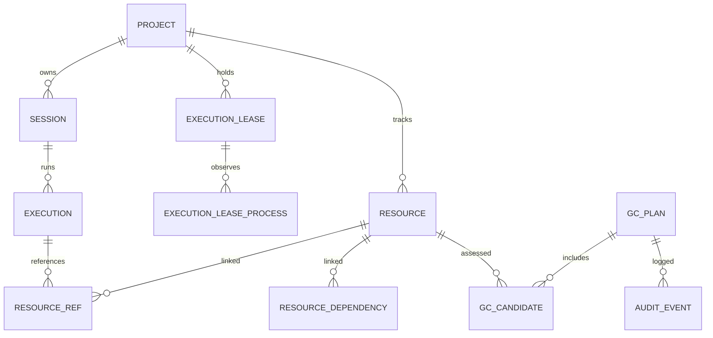

# 데이터 모델 / ERD

## 핵심 테이블
- `project(id, root_path, host_id, created_at, last_seen_at, policy_version)`
- `session(id, project_id, agent_type, pid, process_start, heartbeat_at, state)`
- `execution(id, session_id, command_digest, started_at, ended_at, outcome)`
- `resource(id, kind, provider, external_id, host_id, size_logical, size_reclaimable, last_seen_at, state)`
- `resource_ref(id, resource_id, execution_id, project_id, ref_type)`
- `resource_dependency(parent_resource_id, child_resource_id, reason)`
- `gc_plan(id, project_id, policy_digest, created_at, expires_at, status)`
- `gc_candidate(id, gc_plan_id, resource_id, eligibility_snapshot, confidence, action)`
- `audit_event(id, actor, action, outcome, timestamp, before_digest, after_digest)`

## 실행 lease 저장 구조

- `execution_lease`는 리더 PID와 획득·heartbeat·만료·해제 시각을 보관한다. `mac_observation_complete`는 `NULL`이면 기존 프로세스 그룹 기준, `0`이면 미완료 관측으로 보존, `1`이면 관측이 커밋됐음을 나타낸다.
- `execution_lease_process`는 `lease_id`, `pid`, `started_seconds`, `started_microseconds`를 복합 기본 키로 사용한다. 같은 PID의 서로 다른 실행 세대를 구분한다. 새 관측의 프로세스 등록과 완료 표시 갱신은 같은 트랜잭션에서 처리한다.
- v4는 관측 열과 자손 테이블을 추가한다. macOS에서 이전 활성 PID의 관측은 미완료로 유지한다. v5의 `execution_lease_mac_exit_proof`는 `lease_id`와 부팅 세션 UUID·리더 생성 세대·식별 버전을 보관한다. 관리형 리더 PID와 종료 증거는 한 트랜잭션으로 기록한다. 증거 없는 기존 macOS 관리형 활성 행은 보존하며 새 동기식 파일 GC 소유자는 `mac_owner_process_only`로 식별한다.

## 제약
리소스 삭제 시 참조 개수 및 예상 회수량 독립 계산. 프로젝트 폴더 이동 시 등록 ID를 유지하되 경로 변경 검증. 감사 로그는 append-only 원칙.
