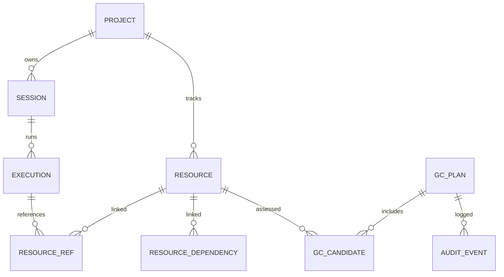

# 데이터 모델 / ERD

## 핵심 테이블
- `project(id, root_path, host_id, created_at, last_seen_at, policy_version)`
- `session(id, project_id, agent_type, pid, process_start, heartbeat_at, state)`
- `execution(id, session_id, command_digest, started_at, ended_at, outcome)`
- `resource(id, kind, provider, external_id, host_id, size_logical, size_reclaimable, last_seen_at, state)`
- `resource_ref(id, resource_id, execution_id, project_id, ref_type)`
- `resource_dependency(parent_resource_id, child_resource_id, reason)`
- `gc_plan(id, project_id, policy_digest, created_at, expires_at, status)`
- `gc_candidate(id, gc_plan_id, resource_id, eligibility_snapshot, confidence, action)`
- `audit_event(id, actor, action, outcome, timestamp, before_digest, after_digest)`

## 제약
리소스 삭제 시 참조 개수 및 예상 회수량 독립 계산. 프로젝트 폴더 이동 시 등록 ID를 유지하되 경로 변경 검증. 감사 로그는 append-only 원칙.
