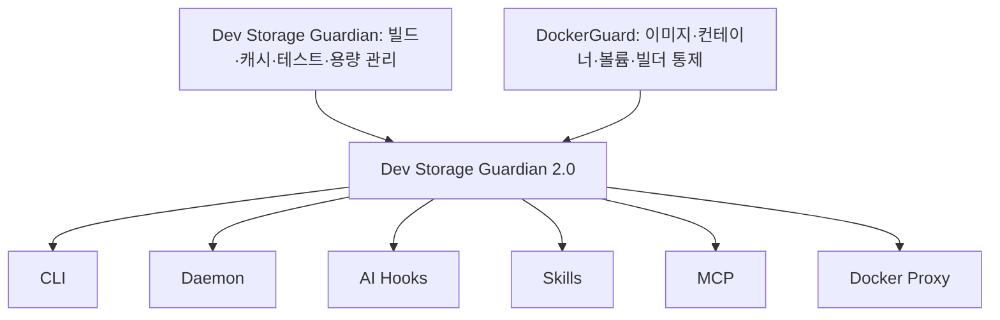
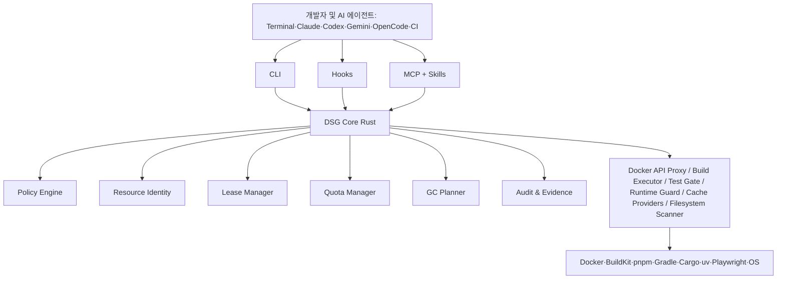
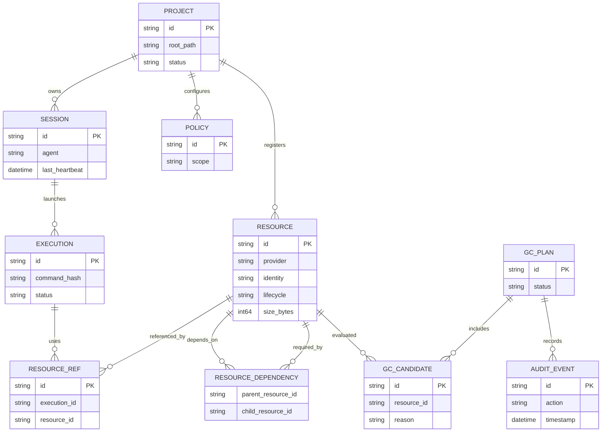

# Dev Storage Guardian 2.0 — AI 코딩 환경 통합 리소스 가드 설계

> 2026년 11월 19일 기준 | 이전 대화 통합 · Rust Core · CLI · Daemon · Docker Guard · AI Hooks · Skills · MCP
>
> **원문 보존 안내:** 앞선 답변의 본문·표·코드·구조·체크리스트를 Markdown으로 재구성한 보존본입니다. 채팅 전용 UI 요소(배지, 박스, 체크박스)는 Markdown 호환 표/체크리스트로 표현했고, 동작형 화면은 `artifact/DSG_2_0_Interactive_Artifact.html`로 별도 제공했습니다. 대화 중의 도구 출처 표식은 일반 URL과 참조 설명으로 치환했습니다. HTML의 화면 효과까지 텍스트로 완전 동일하게 보존하는 것은 불가능합니다.

이전 대화를 확인했습니다. 이번에 구상하는 프로그램은 완전히 새로운 프로젝트로 시작하기보다는 **기존에 논의했던 Dev Storage Guardian(DSG)과 DockerGuard를 하나의 제품으로 통합하고 발전시키는 방향**이 가장 합리적입니다.

최종적으로 만들려는 것은 단순한 디스크 정리 프로그램이 아닙니다.

**사람과 Claude Code CLI, Codex CLI, Gemini CLI 및 다른 AI 에이전트가 프로젝트를 개발할 때 Docker·빌드·실행·테스트에서 발생하는 불필요한 리소스를 생성 전에 통제하고, 이미 생성된 리소스는 안전하게 추적·재사용·정리하는 시스템**입니다.

이 시스템의 중요한 특징은 다음과 같습니다.

- 프로젝트 내부에 관리 프로그램을 매번 설치할 필요가 없어야 합니다.
- 개발자가 수동으로 실행하는 명령과 AI 에이전트의 명령에 동일한 정책을 적용할 수 있어야 합니다.
- macOS, Windows, Linux에서 동작해야 합니다.
- 개발용 프로젝트와 서비스용 Docker 환경을 명확히 분리해야 합니다.
- 동시 세션과 멀티 에이전트 실행에서 서로의 빌드·테스트 환경을 파괴하지 않아야 합니다.
- 실수로 DB 볼륨, 사용자 데이터, 소스 코드, 검증 증거를 삭제하지 않아야 합니다.

## 1. 확인된 이전 대화 및 기존 설계

기존 대화를 시간순으로 확인하면 다음 네 가지가 이번 프로젝트의 직접적인 출발점입니다.

| 날짜 | 이전 대화 | 핵심 내용 |
|---|---|---|
| 2026.10.27 | 개발 빌드 용량 정리 가이드 | Docker·Next.js·Spring Boot·Rust·Tauri·Electron의 누적 빌드 관리, 최근 3개 보관 |
| 2026.10.27 | AI Agent 플러그인형 관리 | Python 기반 Dev Storage Guardian v1.0.0 POC, `dsg run`, Dry-run, 실행 잠금 |
| 2026.11.09 | Docker 중복 생성 방지 가이드 | Rust 상주 데몬, Docker API Proxy, Observe/Warn/Enforce, 리소스 재사용 |
| 2026.11.12 | 개발 저장소 관리 가이드 | Rust Core + CLI + OS Daemon + 글로벌·프로젝트 정책 + AI Hook/Skill 통합 |

**기존 설계 자산**

- `DSG_Complete_Guide.md` — 다중 프레임워크의 빌드 산출물, 캐시, 테스트 증거 통합 관리
- `DockerGuard_Planning_v1.0.md` — Docker 중복 생성 방지 및 실행 전 차단 구조
- `LOCAL_DOCKER_CONTROL_STUDIO_ARCHITECTURE_v1.1.md` — Docker 이미지·레이어·Buildx 캐시의 중복 판정과 리소스 관리
- `DockerGuard_Interactive_Artifact.html` — 정책 및 관리 UI 관련 기존 아티팩트

기존 Python POC에서는 정책 시뮬레이션, Dry-run, 최근 3개 보관, 실행 잠금 등이 제공되었지만, Docker 리소스의 강제 차단, 전역 GC, Rust 데몬, AI CLI 전체 연동까지 구현되었다고 볼 수는 없습니다.

따라서 기존 자산은 버리지 않고 다음과 같이 통합하는 것이 좋습니다.



이제 이 통합 제품을 **DSG 2.0**이라는 가칭으로 설명하겠습니다.

---

## 2. 제품의 핵심 목표와 범위

DSG가 다루어야 할 리소스는 Docker와 빌드 폴더에 한정되지 않습니다.

| 관리 영역 | 관리 대상 | 핵심 기능 |
|---|---|---|
| Docker | 이미지, 컨테이너, 볼륨, 네트워크, BuildKit 캐시 | 중복 탐지, 재사용, 생성 제한, GC |
| Dependencies | pnpm, npm, Gradle, Maven, Cargo, Go, uv | 공유 캐시, 중복 탐지, 공식 GC |
| Build | Next.js, Spring Boot, Rust, Tauri, Electron 등 | 증분 빌드, 재사용, 이력 보관 |
| Runtime | 개발 서버, 테스트 서버, 임시 DB | 중복 실행 방지, 프로세스 추적 |
| Testing | Unit, Integration, E2E, BDD | 실행 잠금, 횟수 제한, 증거 보관 |
| AI Sessions | CLI 세션, 서브에이전트, 작업 디렉터리 | 소유권, 세션별 리소스 추적 |
| Disk | 프로젝트·공유 캐시·호스트 저장소 | 사용량 분석, 임계치, 정리 정책 |

여기서 **빌드 결과물을 무조건 최근 3개만 보관하는 정책과 증분 캐시를 관리하는 정책은 반드시 분리**해야 합니다.

증분 캐시를 계속 삭제하면 CPU 사용량과 빌드 시간이 증가합니다. 반대로 캐시를 무제한 유지하면 디스크 문제가 발생합니다.

따라서 DSG는 보관 기간, 크기, 마지막 사용 시점, 참조 관계, 재생성 비용을 함께 판단해야 합니다.

### 반드시 지켜야 할 6대 원칙

1. **Prevent First:** 사후 삭제보다 불필요한 생성 자체를 먼저 방지합니다.
2. **Reuse Before Build:** 유효한 기존 리소스가 있다면 재사용합니다.
3. **Protect Before Cleanup:** 실행 중인 작업과 영속 데이터는 우선 보호합니다.
4. **Project Ownership:** 모든 관리 리소스를 프로젝트와 세션에 연결합니다.
5. **Bounded Storage:** 캐시 및 산출물의 보관 예산을 설정합니다.
6. **Fail Safely:** 정책 엔진이 오류를 일으켰을 때 위험한 삭제가 실행되지 않도록 합니다.

추가로 운영상 중요한 원칙이 있습니다. DSG가 관리하는 개발 리소스와 사용자가 운영하는 Docker 서비스는 기본적으로 별도의 보호 도메인으로 취급해야 합니다.

## 3. DSG 2.0 전체 아키텍처

설계의 핵심은 **강제 통제 영역과 편의 기능 영역을 분리**하는 것입니다.



### 계층별 역할

| 구성 요소 | 역할 | 필수 여부 |
|---|---|---|
| `dsg-core` | 정책 및 리소스 판단 | 필수 |
| `dsg` CLI | 진단·등록·실행·정리 | 필수 |
| `dsgd` Daemon | 상주 모니터링·예약 정리·세션 관리 | 권장 |
| Docker Proxy | 통제 경로 내 Docker API 생성 요청 차단 | 강제 통제 시 필수 |
| Build/Test Wrapper | 빌드 및 테스트 명령 실행 전 검증 | 강제 통제 시 필수 |
| AI Hooks | AI가 요청한 명령을 사전 검사 | 권장 |
| AI Skills | AI에게 DSG 사용법과 정책 전달 | 권장 |
| MCP Server | AI의 구조화된 DSG 관리 기능 호출 | 선택 |
| Dashboard | 분석·경고·승인 UI | 후속 |

이것을 처음부터 하나의 거대한 데몬으로 개발하기보다는 공통 Rust 라이브러리를 기준으로 기능별 모듈을 분리하는 것이 유지보수와 테스트에 유리합니다.

## 4. Docker Guard — 가장 중요한 강제 통제 모듈

이전에 구상했던 DockerGuard를 별도 프로그램으로 유지하는 대신 DSG의 핵심 Provider로 통합합니다.

### 4.1 Docker 중복의 유형을 구분해야 합니다

Docker 중복 문제는 단순히 이미지 이름이 같거나 개수가 많다는 문제가 아닙니다.

| 유형 | 예시 | 처리 원칙 |
|---|---|---|
| 동일 이미지 ID, 여러 태그 | `app:v1`, `app:latest`가 동일 ID | 실제 레이어 중복 아님 |
| 공유 베이스 레이어 | 여러 서비스가 `node` 기반 이미지 사용 | 레이어 공유량 반영 |
| 동일 컨테이너 구성 | 동일 프로젝트·서비스의 반복 실행 | 기존 컨테이너 재사용 검토 |
| 동일 소스 반복 빌드 | 입력 변경 없이 다시 빌드 | 빌드 생략 또는 캐시 재사용 검토 |
| Buildx 빌더 중복 | 프로젝트마다 불필요한 빌더 생성 | 빌더 재사용 |
| 고아 컨테이너 | 프로젝트 변경으로 참조하지 않는 컨테이너 | 소유권·활성 여부 확인 후 정리 |
| 영속 볼륨 | PostgreSQL 등 DB 데이터 | 중복으로 단정하거나 자동 삭제 금지 |

Docker Compose는 프로젝트명으로 리소스를 구분하므로 DSG가 안정적인 프로젝트 ID를 부여하는 것이 좋습니다. 단, 여러 브랜치를 동시에 실행한다면 프로젝트 ID에 격리된 작업 환경 식별자를 추가해야 합니다.

### 4.2 재사용 판정 알고리즘

Docker 재사용을 다음 단계로 판단합니다.

```text
Request
  ↓
Identify Project / Environment
  ↓
Inspect Docker Context / Engine
  ↓
Resolve Compose Config
  ↓
Compare Service Configuration
  ↓
Compare Image ID / Digest / Build Inputs
  ↓
Check Container Health / Ports / Volumes
  ↓
Acquire Project Resource Lock
  ↓
Reuse / Start / Recreate / Build / Deny
```

`이미지 ID가 같다 = 무조건 재사용`이라는 판정은 위험합니다.

예를 들어 PostgreSQL 이미지가 동일하더라도 데이터 볼륨, 환경변수, 데이터베이스 버전, 서비스 포트, 프로젝트 소유권이 다르면 서로 재사용하면 안 됩니다.

또한 Dockerfile 해시만으로 빌드 결과를 판단해서도 안 됩니다. 소스 파일, 빌드 인자, 베이스 이미지, 플랫폼, 의존성 잠금 파일 등이 결과를 바꿀 수 있습니다.

**정확하게 동일성을 증명할 수 없는 경우에는 빌드를 생략하기보다 BuildKit 캐시를 사용해 정상 빌드하는 것이 안전합니다.**

### 4.3 Docker의 실제 강제 차단 설계

이전 대화에서 가장 중요하게 강조했던 점은 Rust 데몬이 Docker 이벤트를 감시하는 것만으로는 컨테이너 생성을 사전에 막을 수 없다는 것입니다.

| 방식 | 중복 탐지 | 생성 전 강제 차단 |
|---|---|---|
| Docker 이벤트 감시 | 가능 | 불가능 |
| AGENTS.md 등 AI 지침 | 간접 유도 | 보장 불가 |
| AI PreTool Hook | 해당 도구 호출 검사 | Hook 적용 범위 내 가능 |
| `dsg docker ...` 실행 래퍼 | 가능 | 관리형 명령에 가능 |
| Docker API Proxy | 가능 | 프록시 경유 요청에 가능 |
| Engine Authorization Plugin | 가능 | 적용 대상 Engine 요청에 가능 |

Docker Engine은 별도의 Authorization Plugin을 통해 API 요청에 세밀한 접근 정책을 적용할 수 있습니다. 다만 Docker Desktop·Kiri 등 서로 다른 Docker 실행 환경에 동일하게 설치할 수 있다고 가정해서는 안 됩니다.

가장 현실적인 설계는 다음과 같습니다.

**1단계:** DSG CLI 및 Hook을 이용하여 위험한 명령을 검사합니다.

**2단계:** Docker 요청을 DSG Proxy로 중계하도록 합니다.

**3단계:** 관리 대상 프로세스가 Docker Engine에 직접 접근할 수 없도록 소켓 권한·실행 환경을 제한합니다.

**4단계:** 엔진이 지원한다면 Authorization Plugin 등 추가 정책을 적용합니다.

특히 macOS Docker Desktop과 Windows에서는 실행 환경이 Linux VM 내부에 있을 수 있으므로 프록시를 설치하는 방법과 직접 Engine 접근을 차단하는 방법을 구별해야 합니다.

### 4.4 Docker Desktop뿐 아니라 다른 런타임도 고려

최근 검토했던 Kiri와 같은 대체 Docker 실행 환경도 확장 대상으로 고려할 수 있습니다.

```text
DockerProvider
├── DockerEngineAdapter
├── DockerDesktopAdapter
├── BuildxAdapter
├── ComposeAdapter
└── DockerContextDiscovery
```

Kiri처럼 Docker 호환 CLI 또는 API를 제공하는 런타임은 호환성 검사를 거쳐 등록할 수 있습니다. 다만 특정 API, BuildKit 동작, 볼륨 위치, 이벤트 기능이 Docker Desktop과 완전히 동일하다고 가정하면 안 됩니다.

따라서 내부 코드가 Docker Desktop에 직접 종속되지 않는 **Provider 인터페이스 기반 구조**가 적합합니다.

## 5. Build Guard — 언어와 프레임워크별 관리

빌드 관리에서는 언어마다 개별 스크립트를 계속 추가하기보다 공통 인터페이스와 Provider를 구현해야 합니다.

```rust
trait ResourceProvider {
    fn detect(&self, project: &Project) -> Detection;
    fn inventory(&self, project: &Project) -> Inventory;
    fn plan_cleanup(&self, policy: &Policy) -> CleanupPlan;
    fn validate(&self, plan: &CleanupPlan) -> Validation;
}
```

이 코드는 개념적 인터페이스이며 실제 Rust에서는 오류 처리, 비동기 실행, 파일시스템 접근 제약과 플랫폼별 처리를 추가해야 합니다.

### 프레임워크별 기본 관리 정책

| Provider | 발견 대상 | 기본 정리 전략 |
|---|---|---|
| Node/Next | `.next`, `dist`, pnpm Store | 빌드 출력 TTL, Store 공식 정리 |
| Gradle | `build`, 전역 캐시 | 작업 출력 정리, Gradle 자체 캐시 정책 활용 |
| Maven | `target`, `.m2` | 빌드 출력 분리, 의존성 검증 후 정리 |
| Rust | `target`, incremental | 프로파일별 크기·사용 시점 관리 |
| Go | `GOCACHE`, 모듈 캐시 | Go 도구의 정리 기능 활용 |
| Python | `.venv`, pip/uv 캐시 | 사용하지 않는 환경 식별 후 정리 |
| Electron | `dist`, 패키징 결과 | 릴리스 보관 및 임시 패키지 정리 |
| Tauri | Rust target, 앱 번들 | Rust와 번들 산출물 이중 관리 |
| Playwright | 영상·trace·report·브라우저 | 실패 증거 보존, 결과 TTL |

### 중요한 설계 판단

**공유 캐시와 개별 프로젝트 산출물을 다르게 관리해야 합니다.**

예를 들어 pnpm Store는 여러 프로젝트의 패키지 데이터를 공유할 수 있습니다. 단순히 특정 프로젝트의 의존성을 삭제하면서 공유 Store를 제거하면 다른 프로젝트에 영향을 줄 수 있습니다.

Cargo도 글로벌 캐시에 대한 자동 정리 설정을 지원합니다. 따라서 DSG가 모든 파일을 직접 삭제하기보다는 언어·패키지 관리자가 제공하는 공식 기능을 우선 사용해야 합니다.

그리고 프로젝트별로 다음 상태를 유지합니다.

```text
ACTIVE       현재 실행 중이거나 사용하는 산출물
PINNED       사용자 또는 정책이 명시적으로 보호
SHARED       다른 프로젝트와 공유
CANDIDATE    정리 후보
QUARANTINED  복구 가능한 격리 상태
DELETED      검증 후 삭제
UNKNOWN      소유권·사용 여부 불확실
```

`UNKNOWN`은 자동 삭제하지 않습니다.

## 6. Runtime Guard와 Test Guard도 독립적으로 필요

이전 설계에서 빌드 산출물과 Docker가 중심이었다면 DSG 2.0에서는 실행·테스트 통제를 독립 모듈로 승격하는 것을 권장합니다.

### Runtime Guard

AI 에이전트가 Next.js 개발 서버를 여러 번 실행하거나 Spring Boot 애플리케이션을 중복 실행하면 포트 충돌뿐 아니라 메모리와 임시 파일도 증가합니다.

Runtime Guard는 프로젝트 ID, 작업 환경, 실행 명령, 포트, PID와 프로세스 시작 시각을 등록합니다.

기존 프로세스가 실제로 해당 프로젝트에서 시작되었고 상태가 정상이라면 신규 실행 대신 기존 서비스 주소를 반환할 수 있습니다.

단순히 같은 포트를 사용한다는 이유로 기존 프로세스를 종료하지 않아야 합니다.

### Test Guard

E2E 테스트에는 별도의 정책이 필요합니다.

```yaml
test_guard:
  max_concurrent_e2e_per_project: 1
  max_workers: 2
  retries: 0

  evidence:
    screenshots: on_failure
    videos: on_failure
    traces: on_failure
    keep_failed_runs: 3
    max_age_days: 14

  runtime:
    reuse_existing_test_server: true
    terminate_managed_children: true
```

이것은 제안하는 DSG 정책 형식입니다. Playwright 설정 파일에 그대로 넣는 형식은 아닙니다.

테스트 실행은 `dsg test run -- ...`으로 감싸고, 실제 프로세스 트리를 추적하여 브라우저나 테스트 서버가 종료 이후에도 계속 남는지 검사하도록 합니다.

특히 이전에 겪었던 Chrome for Testing 및 Chrome Headless Shell의 과도한 CPU 사용 문제에도 이 실행 통제 방식이 도움이 됩니다.

다만 `workers`를 줄이는 것은 CPU·메모리 사용량을 제어하는 방법이지, 테스트 결과물의 디스크 용량 증가를 직접 제한하는 기능은 아닙니다. 두 정책을 별도로 운영해야 합니다.

## 7. AI CLI · Hook · Skill · MCP의 역할을 명확히 분리

이 시스템을 플러그인 확장도구로 활용할 때 가장 중요한 설계 원칙은 **Skill이 직접 파일을 삭제하거나 Docker를 관리하지 않는 것**입니다.

### 7.1 권장 역할 분담

| 확장 방식 | 용도 | 강제력 |
|---|---|---|
| `AGENTS.md` / `CLAUDE.md` / `GEMINI.md` | 정책과 사용 규칙 전달 | 지침 |
| Skill | 언제 어떤 DSG 명령을 사용할지 안내 | 지침·작업 지원 |
| Hook | 실행 요청을 가로채 정책 검사 | 해당 CLI의 도구 호출 범위 |
| MCP Server | 구조화된 분석·실행 요청 | MCP를 경유하는 요청 |
| DSG CLI | 실제 실행·검사·승인 | 관리형 명령에 적용 |
| DSG Daemon | 상태 추적·GC·동시 실행 제어 | 허용된 시스템 권한 범위 |
| Docker Proxy / 격리 실행 | 우회 경로 제한 | 강제 통제 |

AI가 직접 `rm -rf`, `docker image prune`, `cargo clean`을 판단하도록 두는 것보다, DSG가 정리 후보를 계산하고 승인된 삭제 계획만 실행하도록 설계하는 것이 안전합니다.

### 7.2 공식 Hook 연동 방식 확인

2026년 11월 기준으로 확인한 세 CLI의 주요 Hook입니다.

| 이벤트 | Claude Code | Codex CLI | Gemini CLI |
|---|---|---|---|
| 세션 시작 | `SessionStart` | `SessionStart` | `SessionStart` |
| 명령 실행 전 | `PreToolUse` | `PreToolUse` | `BeforeTool` |
| 명령 실행 후 | `PostToolUse` | `PostToolUse` | `AfterTool` |
| 작업 종료 | `Stop` 등 | `Stop` 등 | `AfterAgent` 등 |

각 도구의 설정 파일, 입력 JSON, 차단 응답 형식은 다릅니다. 하나의 Hook JSON을 세 CLI에 복사해서 사용할 수는 없습니다.

특히 Codex는 현재 Hook을 지원하지만 여러 Hook이 동시에 실행될 수 있으므로 실행 순서에 의존해서는 안 됩니다. 공통 정책 판단 및 잠금 기능은 DSG 엔진에서 원자적으로 처리해야 합니다.

### 7.3 공통 Hook Adapter 구조

```text
adapters/
├── claude/
│   ├── hook-adapter
│   └── skill/
│       └── SKILL.md
├── codex/
│   ├── hook-adapter
│   └── skill/
│       └── SKILL.md
├── gemini/
│   ├── hook-adapter
│   └── skill/
│       └── SKILL.md
└── common/
    ├── normalize-event
    └── decision-response
```

Hook이 실행될 때 각 CLI의 입력을 공통 형식으로 변환합니다.

```json
{
  "agent": "codex",
  "session_id": "session-001",
  "project_id": "shoppingmall",
  "event": "pre-execute",
  "tool": "shell",
  "command": "docker compose up -d --build",
  "cwd": "/workspace/shoppingmall"
}
```

위 JSON은 DSG의 내부 정규화 스키마 예시입니다.

DSG는 다음과 같은 공통 판단을 반환합니다.

```json
{
  "decision": "deny",
  "reason_code": "RESOURCE_ALREADY_RUNNING",
  "message": "기존 Docker 서비스가 정상 실행 중입니다.",
  "suggested_command": "dsg docker status"
}
```

이후 각 CLI Adapter가 해당 CLI의 공식 Hook 응답 형식으로 변환합니다.

이렇게 하면 CLI별로 정책 판단 로직을 중복 구현할 필요가 없습니다.

## 8. 전역·프로젝트·세션별 정책 관리

이전에 요구했던 글로벌 설치와 프로젝트 로컬 정책을 다음과 같이 반영하는 것이 좋습니다.

```text
Global Policy → Project Policy → Session Policy
시스템 공통 안전 정책 / 프로젝트 예산 / 에이전트 실행 예산
상위 보안 정책은 하위 정책이 임의로 완화하지 못하도록 제한
```

프로젝트의 `.dsg.yaml` 파일은 사용자가 관리하는 프로젝트 설정입니다. 따라서 악의적인 코드나 에이전트가 해당 파일을 수정하더라도 시스템 보호 정책을 우회할 수 없도록 해야 합니다.

### 정책 설정 예시

```yaml
version: 2

project:
  id: shoppingmall
  environment: development

mode: enforce

disk:
  project_budget_gb: 30
  host_min_free_gb: 20
  warning_percent: 75
  critical_percent: 90

docker:
  enabled: true
  reuse_containers: true
  stable_compose_name: dsg-shoppingmall
  protect_volumes: true
  protect_external_resources: true
  builder_cache_budget_gb: 10

build:
  prefer_incremental: true
  successful_releases_to_keep: 3
  inactive_output_ttl_days: 14

test:
  e2e_concurrency: 1
  evidence_on_failure: true
  failed_runs_to_keep: 3
  failed_evidence_ttl_days: 14

gc:
  dry_run_first: true
  unknown_resource_action: protect
  require_approval_for:
    - persistent_volume
    - shared_cache
    - unowned_resource
```

이 정책은 앞선 대화의 최근 3개 보관, 최소 여유 공간 20GB, BuildKit 캐시 분리, 활성 리소스 보호 요구를 통합한 초기 설계입니다.

실제로는 프로젝트별 설정을 읽어 검증하는 JSON Schema 또는 TOML/YAML 스키마를 제공해야 합니다.

## 9. 실제 CLI 명령 인터페이스 설계

사용자가 이해하기 쉬운 명령 체계가 필요합니다.

다음은 구현을 권장하는 DSG 2.0 CLI 사양입니다. 현재 동작이 검증된 명령을 나열하는 것이 아니라 신규 구현 대상입니다.

| 명령 | 역할 |
|---|---|
| `dsg doctor` | 환경 진단 |
| `dsg init` | 프로젝트 등록 및 정책 생성 |
| `dsg status` | 현재 프로젝트 리소스 상태 |
| `dsg scan --all` | 모든 등록 프로젝트 분석 |
| `dsg top` | 디스크 사용량이 큰 프로젝트 조회 |
| `dsg docker inspect` | Docker 리소스와 참조 관계 분석 |
| `dsg docker reuse` | 재사용 가능한 리소스 탐지 |
| `dsg build run -- ...` | 관리형 빌드 실행 |
| `dsg test run -- ...` | 관리형 테스트 실행 |
| `dsg dev run -- ...` | 관리형 개발 서버 실행 |
| `dsg gc plan` | 정리 후보와 예상 회수량 계산 |
| `dsg gc apply --plan ...` | 승인된 정리 계획 실행 |
| `dsg protect ...` | 리소스 보호 등록 |
| `dsg agents install` | AI Hook·Skill 설치 |
| `dsg daemon start` | 백그라운드 서비스 시작 |

명령 실행 예시입니다.

```bash
# 프로젝트 초기화
dsg init
# 프로젝트 환경 검사
dsg doctor
# Docker 서비스 상태 및 재사용 검사
dsg docker inspect
# DSG 정책 하에서 Docker 실행
dsg run -- docker compose up -d
# 정책 하에서 Next.js 빌드
dsg build run -- pnpm build
# 관리형 E2E 테스트
dsg test run -- pnpm exec playwright test
# 삭제 없이 정리 대상 분석
dsg gc plan
# 생성된 계획을 다시 검증한 뒤 적용
dsg gc apply --plan plan-001
```

`gc apply`에서는 계획 생성 이후 파일이 변경되었는지, 새로운 프로세스가 참조하고 있는지, 소유권이 바뀌었는지 재검사해야 합니다.

이 검증 없이 오래된 정리 계획을 그대로 실행하면 파일 손실이 발생할 수 있습니다.

### 데몬 동작 방식

- macOS: `launchd` 기반 사용자 서비스
- Windows: 사용자 프로세스 또는 Windows Service
- Linux: 사용자 `systemd` 서비스
- 로컬 통신: Unix Domain Socket 또는 Windows Named Pipe
- 상태 저장: SQLite (WAL, 트랜잭션, 마이그레이션)
- 네트워크: 기본적으로 외부 포트 개방 없음

특히 시스템 관리자 권한을 데몬 전체에 상시 부여하기보다는 필요한 작업만 별도 권한 경계로 분리해야 합니다.

## 10. 리소스 데이터 모델

프로젝트·에이전트·세션·빌드·테스트·Docker의 관계를 추적하려면 단순 로그 파일 이상의 상태 모델이 필요합니다.

초기 SQLite 스키마는 다음 엔터티를 중심으로 구성하는 것을 권장합니다.



추가로 구현할 때에는 다음 사항을 고려해야 합니다.

- PID만으로 실행 중인 프로세스를 식별하지 않습니다. 프로세스 시작 시각도 함께 확인합니다.
- 프로젝트의 경로가 이동하거나 같은 프로젝트가 다른 경로에 복제되더라도 식별이 가능해야 합니다.
- Docker 이미지의 논리적 크기와 호스트 디스크에서 실제 회수 가능한 크기를 구분합니다.
- 리소스가 여러 프로젝트에서 공유되는 경우 참조 수를 계산합니다.
- GC 계획에는 경로, inode 또는 파일 ID, 크기, 수정 시각, 정책 버전 등의 검증 정보를 기록합니다.
- 에이전트 세션 종료와 프로세스 종료를 동일하게 취급하지 않습니다.

이 데이터 모델이 정확해야 사후 정리와 중복 생성 차단의 안전성을 확보할 수 있습니다.

## 11. 개발 프로젝트 디렉터리 구조

Rust Workspace를 사용한 멀티 크레이트 구조를 권장합니다.

```text
dev-storage-guardian/
├── Cargo.toml
├── rust-toolchain.toml
├── README.md
├── LICENSE
├── AGENTS.md
├── CLAUDE.md
├── GEMINI.md
├── crates/
│   ├── dsg-core/
│   ├── dsg-policy/
│   ├── dsg-registry/
│   ├── dsg-lock/
│   ├── dsg-scanner/
│   ├── dsg-gc/
│   ├── dsg-executor/
│   ├── dsg-cli/
│   ├── dsg-daemon/
│   ├── dsg-mcp/
│   └── dsg-docker-proxy/
├── providers/
│   ├── docker/
│   ├── node/
│   ├── gradle/
│   ├── maven/
│   ├── cargo/
│   ├── go/
│   ├── python/
│   ├── electron/
│   ├── tauri/
│   └── playwright/
├── integrations/
│   ├── claude-code/
│   ├── codex/
│   ├── gemini/
│   └── opencode/
├── skills/
│   ├── disk-health/
│   ├── docker-reuse/
│   ├── build-guard/
│   ├── test-guard/
│   └── safe-cleanup/
├── schemas/
│   ├── policy.schema.json
│   ├── event.schema.json
│   └── report.schema.json
├── config/
│   ├── global.yaml
│   └── project.example.yaml
├── tests/
│   ├── unit/
│   ├── integration/
│   ├── e2e/
│   ├── fault-injection/
│   └── fixtures/
├── docs/
│   ├── PRD.md
│   ├── ARCHITECTURE.md
│   ├── SECURITY.md
│   ├── API_SPEC.md
│   ├── TEST_PLAN.md
│   ├── WBS.md
│   └── ADR/
└── scripts/
    ├── install/
    └── release/
```

이 구조에서 `crates`는 공통 엔진의 핵심 구현, `providers`는 프레임워크 및 도구별 통합, `integrations`는 AI CLI 연동, `skills`는 AI에 제공할 사용 지침입니다.

### 플러그인 확장 규격

외부 개발자도 Provider를 추가할 수 있도록 최종적으로 다음과 같은 확장 구조를 지원하는 것이 좋습니다.

```yaml
id: dsg.provider.example
version: 1.0.0
api_version: 1
detect:
  files:
    - example.lock
capabilities:
  - scan
  - inventory
  - cleanup_plan
permissions:
  filesystem: project_only
  destructive_actions: false
```

초기 버전에서는 플러그인을 자유롭게 실행하는 것보다 정적으로 연결한 신뢰 가능한 Provider를 우선 제공하고, 외부 플러그인은 별도 프로세스와 제한된 권한으로 실행하는 방향을 권장합니다.

## 12. MCP와 Skill 설계

DSG는 AI 에이전트가 사용할 수 있는 MCP 서버를 제공하되, MCP가 반드시 설치되어야만 동작하는 제품이 되어서는 안 됩니다.

권장 MCP 인터페이스는 다음과 같습니다.

| MCP 도구 | 기능 |
|---|---|
| `dsg_get_health` | 디스크 및 전체 시스템 상태 |
| `dsg_scan_project` | 프로젝트 리소스 분석 |
| `dsg_inspect_docker` | Docker 중복 및 참조 관계 |
| `dsg_check_command` | 명령 실행 전 정책 판단 |
| `dsg_get_gc_plan` | 정리 계획 조회 |
| `dsg_get_execution_status` | 실행 상태 조회 |
| `dsg_get_policy` | 적용된 정책 확인 |

삭제나 프로세스 종료처럼 실제 상태를 변경하는 MCP 도구는 읽기 전용 도구와 분리하고 승인 절차를 적용합니다.

Skill에는 긴 기술 설명보다 실행 절차를 담아야 합니다.

예를 들어 `docker-reuse/SKILL.md`는 다음 순서로 구성합니다.

1. `dsg docker inspect`를 호출합니다.
2. 기존 리소스와 서비스 상태를 확인합니다.
3. 재사용 가능한 경우 새 컨테이너를 생성하지 않습니다.
4. 새로운 이미지가 필요한 경우 `dsg run`으로 빌드를 요청합니다.
5. 거부되면 DSG의 오류 코드와 대체 명령을 따릅니다.

이 접근은 토큰 절감에도 유리합니다. AI에게 수천 줄의 리소스 현황을 전달할 필요 없이 DSG가 판단한 구조화된 결과만 제공하면 됩니다.

## 13. 반드시 검증해야 할 POC 시나리오

가장 중요한 것은 기능 구현 숫자가 아니라 **오작동 시 사용자 데이터가 손상되지 않는다는 사실을 검증하는 것**입니다.

### POC 검증 체크리스트

- [ ] 동일 Compose 프로젝트 10회 실행 시 불필요한 컨테이너 증가 없음
- [ ] 변경 없는 빌드의 캐시 재사용 및 실제 입력 변경 시 정상 재빌드
- [ ] PostgreSQL 볼륨·사용자 파일 자동 삭제 0건
- [ ] 서로 다른 프로젝트의 공유 캐시 보호
- [ ] Claude·Codex·Gemini에서 동일 정책 판단
- [ ] 두 AI 세션의 동시 실행 시 중복 생성 및 잠금 충돌 방지
- [ ] 활성 개발 서버·브라우저 프로세스 보호
- [ ] E2E 성공/실패 증거 보관 정책 검증
- [ ] GC 계획 생성 후 상태 변경 시 삭제 거부
- [ ] macOS·Windows·Linux 기본 실행 및 플랫폼별 차이 검증
- [ ] Docker Engine 직접 접근 우회 시나리오 검증
- [ ] 비정상 종료·전원 차단 후 상태 복구

### 테스트별 중점 사항

**Unit Test:** 정책 우선순위, 리소스 해시, 참조 계산, 삭제 후보 결정, 파일 경로 경계 검증.

**Integration Test:** Docker Engine API, SQLite 동시 트랜잭션, 실제 pnpm·Gradle·Cargo 캐시 구조.

**E2E Test:** 세 CLI의 Hook 호출, 명령 차단, 개발 서버 재사용, 테스트 결과물 생성·정리.

**Fault Injection:** 데몬 비정상 종료, GC 중단, 파일 변경, 잠금 분실, Docker Engine 재시작, 디스크 공간 부족.

**Security Test:** 심볼릭 링크 탈출, 경로 조작, Docker 소켓 직접 접근, 플러그인의 무단 파일 삭제, 악의적인 프로젝트 설정.

이 가운데 가장 중요한 릴리스 게이트는 다음 세 가지입니다.

- 보호 대상 데이터 삭제 0건.
- 관리형 실행 경로의 정책 우회 0건.
- 재사용 판정으로 인해 잘못된 버전의 빌드나 컨테이너가 실행되는 사례 0건.

이는 테스트 통과 목표이며, 실제 시스템에서 모든 상황에 대한 무결성을 무조건 보장한다는 뜻은 아닙니다.

## 14. 단계별 개발 로드맵

저는 6단계로 개발하는 것을 권장합니다.

| Phase | 개발 범위 | 완료 기준 |
|---|---|---|
| 1. Foundation | Rust Core, SQLite, Policy, CLI, 파일 스캐너 | 프로젝트 등록·사용량 분석·Dry-run |
| 2. Docker Guard | Docker Engine/Compose/Buildx 검사, 재사용 판단 | 중복 생성 탐지와 안전한 관리형 실행 |
| 3. Build/Test Guard | Node, Gradle, Cargo, Python, Go, Playwright | 빌드·테스트 산출물 추적 및 안전 정리 |
| 4. AI Integration | Claude·Codex·Gemini Hook, Skill, MCP | 동일 정책 적용 및 차단 검증 |
| 5. Enforcement | Docker Proxy, 권한 분리, Daemon, GC | 지원 환경에서 우회 제한 및 자동 관리 |
| 6. Productization | 설치 프로그램, 업데이트, Dashboard, 확장 SDK | 다중 OS 검증 및 배포 가능 제품 |

Phase 1~3까지 구현하면 이미 상당 부분의 하드 용량 문제를 해결할 수 있습니다. 그러나 사용자가 원했던 **AI 에이전트의 무제한 신규 생성 방지**까지 달성하려면 Phase 4~5의 통제가 필요합니다.

## 15. 이번 프로젝트에서 추가로 권장하는 세 가지 기능

### A. Disk Forecast — 용량 증가 예측

단순히 현재 사용량만 표시하는 것보다 프로젝트의 증가 속도를 기록해야 합니다.

예를 들어 지난 7일간 빌드·테스트로 증가한 용량과 회수 가능한 공간을 계산하여, 현재 추세가 계속되면 언제 임계치에 도달할지 추정합니다.

이렇게 하면 사용자가 디스크 부족을 경험하기 전에 정리할 수 있습니다.

### B. Resource Ownership Explorer — 리소스 소유권 추적

Docker 이미지나 Gradle 캐시가 어느 프로젝트에서 사용되는지, 어떤 AI 세션이 생성했는지, 마지막으로 언제 사용되었는지를 조회하는 기능입니다.

이는 여러 프로젝트를 동시에 유지보수할 때 특히 가치가 큽니다.

### C. Safe Recovery — 정리 전 복구 가능성 확보

일반적인 프로젝트 빌드 폴더는 격리 디렉터리로 이동했다가 일정 기간 후 삭제할 수 있습니다.

반면 Docker 이미지와 BuildKit 캐시는 같은 방식으로 이동시키기 어렵습니다. Provider가 지원하는 제거 절차를 활용하고, 삭제 전에 참조 관계를 확인해야 합니다.

따라서 모든 리소스에 동일한 휴지통 방식을 적용하지 말고 **복구 가능한 리소스와 복구 불가능한 리소스를 구분한 GC 엔진**을 구현해야 합니다.

## 16. 최종 기술 의사결정

| 항목 | 최종 권장 |
|---|---|
| 프로젝트 이름 | Dev Storage Guardian (DSG) 2.0 |
| 구현 언어 | Rust |
| 아키텍처 | Modular Core + Provider/Adapter |
| 로컬 DB | SQLite |
| 실행 형태 | CLI + 선택적 Daemon |
| Docker 관리 | Compose/Engine/Buildx Provider |
| 강제 Docker 통제 | 관리형 Proxy + 권한 경계 |
| AI 지원 | Claude Code, Codex, Gemini, 추후 OpenCode |
| 확장 | Hook + Skill + MCP + Provider SDK |
| 설정 | Global + Project + Session |
| 보관 | 릴리스 최근 3개, 캐시 용량/기간 기반 |
| 안전 모드 | Observe → Warn → Enforce |
| 지원 OS | macOS, Windows, Linux |
| 배포 형태 | OS별 네이티브 실행 파일 |
| 인터넷 연결 | 런타임 핵심 기능은 오프라인 동작 |
| 개발 방식 | SSOT + Harness + TDD + E2E + 증거 기록 |

이전 대화와 이번 요청을 종합하면, **DSG와 DockerGuard를 별도 제품으로 개발할 이유는 크지 않습니다.** Core와 정책은 통합하고 DockerGuard를 독립 Provider로 만드는 편이 더 적합합니다.

다만 처음부터 완벽한 OS 전역 강제 통제 프로그램을 목표로 구현하면 난도가 상당히 높아집니다. 따라서 초기 버전은 안전한 분석·관리형 실행·Dry-run·Docker 재사용을 우선하고, 실제 데이터와 동작을 검증한 다음 강제 통제를 활성화하는 순서가 좋습니다.

또한 기존 Python DSG v1.0.0은 회귀 검증의 기준점으로 유지하고 Rust 2.0을 별도 구현하는 것을 권장합니다. 기존 POC를 무조건 폐기하거나 검증되지 않은 기능을 완성된 기능으로 간주해서는 안 됩니다.

**결론적으로 이 프로젝트의 핵심 경쟁력은 디스크 정리 자체가 아니라, AI 코딩 에이전트가 생성하는 개발 리소스의 전체 수명주기를 중앙에서 통제한다는 데 있습니다.** 이 원칙을 기준으로 설계하면 여러 AI CLI, 프레임워크, Docker 실행 환경이 추가되더라도 하나의 관리 체계로 확장할 수 있습니다.

### 출처 및 별도 확인

- [Docker Build GC](https://docs.docker.com/build/cache/garbage-collection/)
- [Docker Authorization](https://docs.docker.com/engine/extend/plugins_authorization/)
- [Codex Hooks](https://learn.chatgpt.com/docs/hooks)
- [Gemini Hooks](https://geminicli.com/docs/hooks/reference/)
- [Cargo 설정](https://doc.rust-lang.org/stable/cargo/reference/config.html)

> 원문의 미래형 설계/CLI 예시는 **개발 계획**입니다. 본 패키지의 Python POC 명령과 혼동하지 마십시오.
